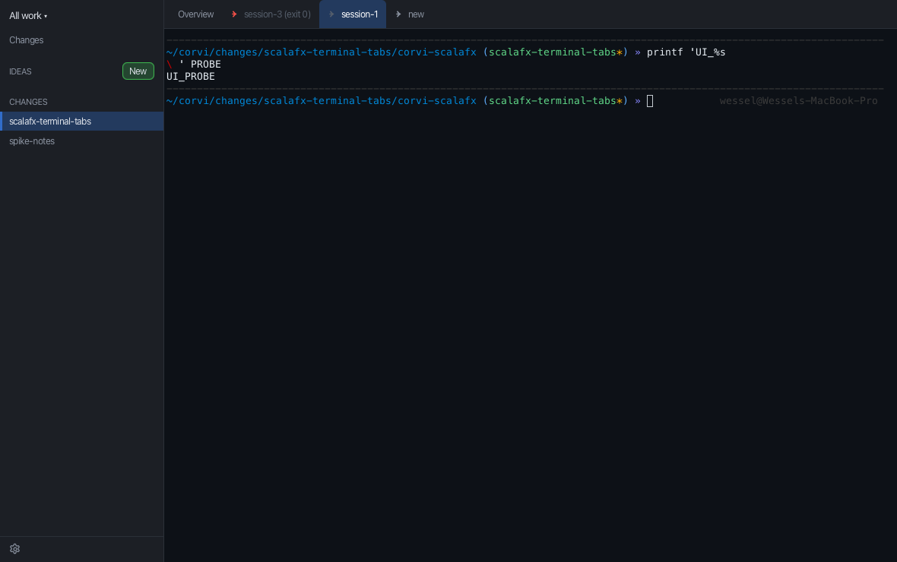

# corvi-scalafx

[](https://github.com/wwbakker/corvi-scala/actions/workflows/ci.yml)

A feasibility spike: Corvi's terminal screen — a tab strip of real PTY-backed terminals — rebuilt as a Scala 3 desktop
application, to answer whether the Electron app could be a JVM app instead.

Scala 3.10 · Mill 1.3 · [Kyo](https://github.com/getkyo/kyo) 1.0.0-RC7 · ScalaFX (JavaFX 26) · JediTermFX for VT
emulation · pty4j for the PTY. macOS arm64 in practice; the build picks the right OpenJFX classifier for macOS, Windows
and Linux, but only macOS has been run.

This is one screen, not the app: no changes, dashboards, subagents, settings, persistence or remote workspaces.

## Two processes

The rewrite splits the old single-process spike in two, and that split is the design:

| process | what it is | what it owns |
| --- | --- | --- |
| `corvi-host` (`host` module) | a long-lived daemon: a `KyoApp` with no JavaFX at all | the PTYs, one headless `jeditermfx-core` emulator per session, 5,000 rows of history per session, the Unix socket |
| `corvi-ui` (`app` module) | the ScalaFX window: `JFXApp3` | the sidebar, tab strip, Overview and one thin rendered view per session |

The UI starts the host if nothing answers, then connects to its Unix domain socket and attaches. **The host
interprets the terminal; the UI only paints.** A `Snapshot` is the visible grid, the cursor, the modes and the history
depth; a `Damage` is what changed (the rows whose cells differ, plus cursor/modes/title/history/size where those differ).
The UI never parses terminal bytes — a renderer that did would be the thing this rewrite replaces.

The consequence is the point: a UI restart is a **reattach**. The shells are untouched, and each screen comes back
exactly as the host holds it. (If the *host* dies, the shells are gone — see the limits.)

## Modules

| module | contents | depends on |
| --- | --- | --- |
| `contract` | DTOs and the pure `Frame` consumer: `SessionId`, `SessionInfo`, `Snapshot`/`Damage`, `TerminalView`/`TerminalViewFactory` | — |
| `protocol` | `kyo-jsonrpc` routes, schemas, typed errors, the client half (`TerminalService`), the Unix-socket byte seam | contract |
| `host` | PTY + VT emulator, `HostSession`/`HostSessions`, the daemon's routes, the daemon itself | contract, protocol |
| `renderer` | `Frame` → pixels: layout, painter, canvas, selection, scrollback, the session-call seam | contract, protocol, ScalaFX |
| `ui` | sidebar, tab strip, Overview, `ShellState`, chords — written against the `contract` seam only | contract |
| `app` | the composition root: host connection, `Client`, the view factory, `ShellApp` | renderer, host, ui |
| `host.test`, `renderer.test`, `ui.test`, `app.test` | every probe, harness and test. **Production modules contain no test code** | their module |

`ui` is deliberately independent of `renderer` (it can be driven by a fake factory), and `renderer` cannot see the host
(a renderer that linked the VT engine could parse bytes "just this once"). Whatever needs both lives in `app`.

The **client has one runtime**: `Client` is a command queue served by a single fiber on the runtime that owns the
connection and its reader; the views submit attach/text/resize/history/close and get their events back on the FX thread.
A view never starts a runtime of its own.

## Running it

```bash
./mill --no-daemon app.run                       # the Corvi window (starts the host if needed)
./mill --no-daemon host.runMain corvi.host.HostMain   # the daemon alone, in the foreground
```

> Use `--no-daemon` (equivalently `-i`) on this machine: Mill 1.3.0's **daemon** can die at startup with
> `Mill daemon terminated unexpectedly` / `watchProcessIdFile: processId file missing` before the build is
> defined. That is Mill's daemon/launcher race, not this app — the window and host are unaffected when Mill
> runs in-process (`./mill -i app.run` also works). The probes below already use `-i`.

The tests live in the test modules: JUnit 5 for the pure core, TestFX for the window, and the `runMain` probes for the
parts that need a real PTY, a real daemon or a real scene. Each probe prints `PASS`/`FAIL` per check and exits non-zero on
failure.

```bash
./verify                                                # format check, every suite, then the five probe mains
./verify --quick                                        # the suites only
./mill --no-daemon __.test                              # every JUnit/TestFX suite in the build
./mill -i ui.test                                       # 25 JUnit tests: ShellState transitions, the chord matrix
./mill -i renderer.test                                 # 14 JUnit tests: ScreenModel, Layout, Selection
./mill -i app.test                                      # the TestFX suite: the daemon-backed window, end to end
./mill -i host.test.runMain corvi.host.HostProbe        # 49 checks: PTY, VT emulation, snapshot/damage, history, resize
./mill -i host.test.runMain corvi.host.ProtocolProbe    # 30 checks: routes, typed errors, auth, pushes, reconnects
./mill -i host.test.runMain corvi.host.HostDaemonProbe  # 23 checks: the socket daemon, token, stop, leaks, liveness, pushes
./mill -i app.test.runMain corvi.app.RendererProbe      # 31 checks: the renderer, selection, scrollback, captures
./mill -i app.test.runMain corvi.app.UiProbe            # 29 checks: the window, tabs, chords, bells, menus, drag
./mill -i app.test.runMain corvi.app.RendererSnapshot   # writes out/corvi-renderer.png and out/corvi-renderer-unfocused.png
```

`app.test` passes a socket of its own through `forkEnv` (a short `/tmp` path: a Unix socket path is limited to ~104
bytes) and kills the daemon it started, so it never touches the user's host. It drives the window with the same JavaFX
press/release/click events a person sends — the sequence that caught the tab bug — rather than TestFX's glass robot,
because on macOS that robot needs Accessibility permission for the process and drops its events silently without it.

`UiProbe` also writes `out/corvi-ui.png`, and `RendererSnapshot` writes the renderer's two. Those files are build output
(`out/` is ignored); the captures are kept under `docs/screenshots/` — a snapshot of the scene is how this machine
(reachable only through a display *server*, with no screen-recording permission) can be looked at:



```bash
./mill -i mill.scalalib.scalafmt/reformatAll     # format
./mill -i mill.scalalib.scalafmt/checkFormatAll  # verify
```

The design and the reasoning behind it are in [`docs/kyo-architecture.md`](docs/kyo-architecture.md); the coding guide
for this code base is the first-party skill in [`.agents/skills/kyo-scala/`](.agents/skills/kyo-scala/README.md).

## What it does

- **One window shaped like Corvi's**: sidebar (decoration), tab strip `Overview | <windows…> | new`, and the well the
  terminals live in.
- **Real terminals.** `new` opens a login shell (`$SHELL -l`, `TERM=xterm-256color`) on a PTY in the daemon; the window
  renders the host's screen.
- **Tabs from state.** Opening selects the new window; clicking a tab shows it and takes the keyboard; every pane stays
  mounted, so background shells keep running. Right-click offers `Close tab`, which also ends the session.
- **A bell** (`--warn` dot) on a tab whose shell produced output while you were looking elsewhere. Output in the window
  you *are* looking at changes nothing and repaints nothing.
- **Ended windows.** `exit` marks that tab ended and keeps its final screen; a natural exit shows its code
  (`session-3 (exit 0)`), a reader failure carries its reason in the tooltip, and a tab you closed says so without a
  marker. An ended tab never bells.
- **Drag** a tab onto another to reorder; the selection follows the tab that moved. An open tab menu is not closed by a
  bell on another tab.
- **Overview** is the way back to the placeholder, and the strip's fixed left end.

### Chords

| chord | what it does |
| --- | --- |
| `⌘T` (macOS) / `ctrl-alt-t` | new terminal |
| `ctrl-b c` | new terminal (tmux-style) |
| `ctrl-b <n>` | switch to window `n` — **0-based** |
| `⌘W` (macOS) | close the terminal on screen |
| right-click a tab → `Close tab` | close it, on any platform |
| `⌘C` / `ctrl-shift-C` | copy the selection |
| `⌘V` / `ctrl-shift-V` | paste |

### Keys

**Control keys work, with a terminal's meanings.** Control and a letter is sent as its C0 byte (Ctrl+A `^A` … Ctrl+Z `^Z`, Ctrl+Space
NUL, Ctrl+`[` Escape, Ctrl+`?` Delete), so **Ctrl+C interrupts** and **Ctrl+D ends the shell** — the host's PTY receives the byte and
does the rest. Copy and paste are the window's own chords: **⌘C / ⌘V on macOS**, and **Ctrl+Shift+C / Ctrl+Shift+V** as the alias
elsewhere. Ctrl+C is never a copy chord; the plain printable keys, Shift-only characters, Backspace (`^?`), Enter, Tab and Escape are
forwarded as before, and a shortcut's typed companion (the `c` the platform sends after ⌘C) is swallowed rather than typed.

**Option-composed characters pass through**: Option+E / Option+U / Option+A / Option+5 / Option+G enter é/ü/å/∞/© as the platform composes
them, because Alt is not treated as a shortcut here — its `KEY_TYPED` is the text. Alt-as-Meta/Alt-as-Escape is **not** forwarded: Alt is
passed as a composed character, not as the terminal's Meta prefix.

Paste is **not** wrapped in bracketed-paste escapes: a multi-line paste runs each line, so pasting a script executes it (Corvi's own
bracketed-paste handling is a follow-up). Not implemented, deliberately: find, hyperlinks, font-size and `⌘-click`. **Arrow keys,
modified function keys and mouse reports are still not forwarded**: they need the host's mode-dependent encoding and a `session.key`/`session.mouse` route, which is a renderer
follow-up.

## Where the state lives

| | |
| --- | --- |
| shells, PTYs, screens, history | the **host** process, per session |
| which tabs exist, which is selected, bells, ended state | the **UI**, in one immutable `ShellState` with pure transitions |
| each session's rendered frame | the **UI**, one cached frame per session, updated by damage for *all* sessions |
| theme | `SessionInfo` (the renderer needs it for a cell with no colour of its own) |
| title, mouse mode, alternate screen | the frame's `Modes`, because they change with the terminal's state |

History is capped at 5,000 rows per session (Corvi's own default). Damage is absolute and idempotent: applying it twice
is the same as once, and a stale delta after a resize is dropped rather than thrown. A resize is debounced by the side
that owns the window (500 ms, 100 ms on the alternate screen) and applied by the host, under the same lock the emulator
takes per operation.

## The socket, the token, reattaching

- **Where.** `$XDG_RUNTIME_DIR/corvi-scalafx/host.sock`, else `~/.local/state/corvi-scalafx/host.sock`. The directory is
  0700; the socket and the token beside it are 0600. `CORVI_HOST_SOCKET` overrides the path (the token sits next to it),
  which is how the probes run daemons without touching the default one. The name is namespaced away from the installed
  Corvi app's own socket: this spike never binds, replaces or deletes that one.
- **Token.** 32 random bytes, hex, created atomically and reused, so a UI restart reads the file the daemon did. Every
  connection starts unauthorised; `host.hello(token)` is the only call it can make, and the comparison is constant-time.
- **One daemon.** Binding the socket is the lock, within this daemon's family. An `host.sock.owner` marker records the pid;
  a socket whose marker names a dead pid is this daemon's own predecessor and is replaced; a socket with no marker is
  somebody else's and is never unlinked.
- **Starting.** The UI connects, and if nothing answers spawns the daemon with this JVM's own `java`, classpath and Kyo
  flags, detached (no handle kept, stdin `/dev/null`, output written to `host.log`, truncated on every spawn). Then it
  waits for the socket and says hello.
- **Reattaching.** A UI start is `sessions.list`, `attach` for each session, seed the frame, then live pushes. Damage is
  pushed per client from that client's own baseline, so two clients can watch the same host without disturbing each other.
- **Stopping.** `host.stop` ends the accept loop; the sessions are released (their shells destroyed), the socket and the
  owner marker are unlinked, and the process exits. There is no idle exit: the daemon lives until stopped or killed.

## Where it stands

### Measured on this build

| | |
| --- | --- |
| `app` run classpath | **57 entries, 55.3 MiB in total**: 50.7 MiB of third-party jars, 4.6 MiB of our own classes and resources |
| its largest jars | scala-library 9.38, javafx-graphics 5.23, scalafx 4.20, kyo-core 3.10, pty4j 2.68, javafx-controls 2.49, kyo-schema 2.28 MiB |
| processes at runtime, one terminal | the UI JVM, the `host` daemon JVM, and one login shell as the daemon's child (checked with `ps`) |

### From the previous single-process spike — **not this build's numbers**

The startup and memory figures below were taken on the removed Ox implementation — the single-process spike with its own
snapshot harness, which no longer exists:

| measure (old spike) | |
| --- | --- |
| JVM start → window on screen | 790–836 ms |
| JVM start → first prompt painted | 1179–1218 ms |
| RSS, one terminal / three terminals | 266–293 MB / 280–340 MB |

This build adds a second JVM (the daemon) and an IPC hop, so those numbers understate it; **they have not been
re-measured here**. The Electron figures were collected in the same earlier pass and were not re-sampled either:
`Corvi.app` is 286 MB (`Electron Framework.framework` alone 284 MB) and the running app summed to 0.76–0.89 GB of RSS
across five or six processes after hours of use. The samples are not the same age and the sums double-count shared
pages; treat them as orders of magnitude, not a benchmark.

### The verdict, updated for two processes

The split buys the thing the single-process spike could not do: the window can die and come back without killing the
shells, because the shells live in a daemon. It costs a second JVM to run, a socket and a token between them, and a
protocol whose deltas must be right (absolute, idempotent, per-client baselines). In exchange the UI is genuinely thin —
no VT engine, no PTY, no terminal bytes — and a tab switch is a visibility change over cached frames.

The JVM side is still one language and one build for the whole screen, a 55.3 MiB classpath (4.6 MiB of it ours, the
rest jars) instead of a 284 MB browser framework, and no Chromium. The price is still a JVM boot before anything is drawn and a memory
footprint that does not shrink to a thin client's. Whether the trade is right depends on the rest of Corvi, which this
spike does not measure.

### Fixed after the first reviews

The window lifecycle, the tab strip and the host's client registry each had a bug the probes missed; the tests below now cover them.

- **Tabs stopped switching** after the first click on a tab. A tab's press set `TabDrag.Pressed` and only a completed drag or a drop
  cleared it; any render while a gesture is in flight is deferred, so every later state change updated the model and painted nothing.
  The release clears a press that never became a drag, and both `UiProbe` and `UiTest` now click with the real press/release/click
  sequence instead of firing `MOUSE_CLICKED` alone.
- **A blank first frame (the "black terminal")** came from `HostSessions.bind`: it read the client map and wrote it back (`clients.use`
  then `clients.set`). The liveness-probe connection and the app's connection bind concurrently at startup, so each could write back the
  map it had read and the later write silently dropped the other handler. That client had already attached, stayed in the session's
  `attached` map with its socket open, and the push loop computed its damage and dropped it (`no handler for …`) forever — a blank screen
  with a live connection. `bind` is now one atomic `getAndUpdate`; `pushDamage` also self-heals a client whose handler has gone (drops it
  from the baselines and reports it once), and the unbind path clears both maps. **Evidence:** fifteen consecutive
  `./mill --no-daemon app.test.testOnly corvi.app.UiTest` runs green, each painting the prompt in ~3.6 s, and the new
  `corvi.host.BindTest` (64 concurrent binds over 8 threads) fails against the old read-then-set and passes against `getAndUpdate`.
- **A second, empty window.** `JFXApp3.AutoShow` is off, the primary stage is the only window, and it is shown immediately with a
  `StatusView` placeholder ("Connecting to the host…") that is replaced by the shell when the client answers — or by the failure, in the
  window. Nothing waits on the FX thread for the host. `UiTest` asserts the one window over the same `AppWindow` assembly `ShellApp` uses;
  the `JFXApp3`/`AutoShow` wiring itself is covered by running the app (`./mill --no-daemon app.run`), because a second
  `Application.launch` in one test JVM is not possible.

## Known limitations

- **No reconnect when the host dies.** The UI attaches once; if the daemon goes away the window keeps the last frames it
  received. The architecture makes the host's death the shells' death, so this is recorded rather than hidden: restart
  the window to reconnect to whatever host answers then. A UI restart against a *live* host works — that is the case in
  scope.
- **No idle exit for the daemon**, and no `setsid`: a launcher that kills its whole process group takes the daemon with it.
  A packaged app needs its own launcher, and packaging itself is out of scope.
- **Unix socket only.** Windows (a TCP or named-pipe transport) is not implemented; the transport seam is the only part
  that would change.
- **Arrow keys and mouse reports are not forwarded** (see [Keys](#keys)). Control keys, copy and paste are; the mode-dependent key and
  mouse encoding lives in the host's future.
- **No find, no hyperlinks** in the renderer, and no IME.
- **macOS arm64 is the only exercised platform.** The build selects the right classifier elsewhere; nothing else has run.
- **No packaging.** No `jpackage`/`jlink`, no app bundle, signing, update path or icon.
- **The UI probes need a display server** (not a visible display); they drive real JavaFX events and real processes.
  `ui.test` and `renderer.test` need neither a display nor a host — they are the pure core, checked as values in and
  values out.
- **No host-restart survival** and no session persistence across a host restart.

## Layout

```
build.mill                      six modules, OpenJFX classifiers, Kyo/JavaFX/pty4j deps, the compiler flags
docs/kyo-architecture.md        the design: processes, protocol, damage, daemon, renderer, the shell, limits
.agents/skills/kyo-scala/       the coding guide: Kyo, the JavaFX boundary, probes-as-tests
contract/src/corvi/contract/    DTOs and the pure Frame consumer
protocol/src/corvi/protocol/    routes, schemas, typed errors, TerminalService/TerminalClient, SocketWire
host/src/corvi/host/            HostMain, HostSession(s), HostRoutes, SocketWire usage, the three host probes
renderer/src/corvi/renderer/    Layout, ScreenModel, TerminalPainter/Canvas, TerminalView, TerminalSession
ui/src/corvi/ui/                ShellView, ShellState, TabStrip, Sidebar, Chords, Theme, Stylesheet, corvi.css
app/src/corvi/app/              ShellApp, HostConnection, Client, RendererViewFactory, Harness, the app probes
```

`.pi/mcp.json` wires the Metals MCP server over Mill's own BSP (`./mill mill.bsp.BSP/install`), so `build.mill` is the
single source of the project model.
